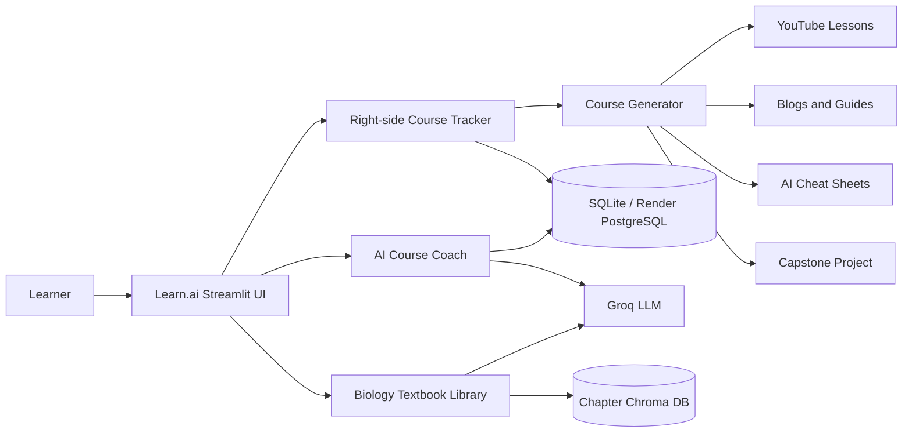

# Learn.ai

Learn.ai turns any topic into a personalized mini-course. A learner enters a topic such as Docker, Genetics, or Financial Modelling, and the application assembles video lessons, useful articles, AI-generated cheat sheets, measurable progress, and a practical capstone project.

The original Class 12 Biology textbook assistant remains available as a separate workspace.

## Product experience

- **AI course builder:** creates a structured path for any learner-supplied topic.
- **Real learning resources:** collects four YouTube lessons and three blog/tutorial links.
- **Topic-specific cheat sheets:** generates three concise references with commands, formulas, definitions, or recall cues.
- **Right-side course tracker:** courses appear as independent panels, similar to a chat list, without requiring the learner to scroll through old messages.
- **Live progress:** every completed resource updates the “You've learned 50% / 70% / 100%” indicator.
- **Capstone project:** unlocks after the learning resources reach 100%.
- **AI project mentor:** helps plan, implement, debug, review, and finish the unlocked project.
- **Per-learner persistence:** courses and completion states are stored by learner profile in SQLite locally or PostgreSQL on Render.
- **Biology library:** preserves textbook-grounded Class 12 Biology answers, PDF page sources, automatic chapter switching, and video references.

## Interface architecture



## Course lifecycle

1. Enter a learner profile name.
2. Type any topic in **Create a course**.
3. Learn.ai collects videos and articles and generates cheat sheets.
4. Mark each resource complete from the independent tracker panel.
5. Watch the learning percentage update automatically.
6. Reach 100% to unlock a topic-specific portfolio project.
7. Ask the AI Course Coach for project planning, code, debugging, or feedback.

## Project structure

```text
project_StudyHere/
├── src/
│   ├── main.py                # Learn.ai interface and right-side tracker
│   ├── course_utility.py      # Course generation, persistence, progress, AI coach
│   ├── get_yt_video.py        # Generic and Biology YouTube discovery
│   ├── chatbot_utility.py     # Biology RAG assistant and chapter routing
│   ├── vectorize_book.py      # PDF extraction and Chroma indexing
│   └── vectorize_script.py    # Vectorization command-line entry point
├── data_original/             # Class 12 Biology source PDFs
├── chapters_vector_db/        # Generated locally; ignored by Git
├── vector_db/                 # Generated locally; ignored by Git
├── runtime_data/              # Local SQLite progress data; ignored by Git
├── requirements.txt           # Full local/Biology dependencies
├── requirements-render.txt    # Lightweight Learn.ai production dependencies
└── render.yaml                # Render web service + PostgreSQL Blueprint
```

## Local setup

### 1. Create and activate a virtual environment

```powershell
python -m venv .venv312
.\.venv312\Scripts\Activate.ps1
```

### 2. Install dependencies

```powershell
python -m pip install --upgrade pip
pip install -r requirements.txt
```

### 3. Configure environment variables

Create `src/.env` from `src/env_tamplate.txt`:

```env
GROQ_API_KEY=replace_with_your_key
GROQ_MODEL=openai/gpt-oss-20b
CLASS_SUBJECT_NAME=class_12/biology
```

`DATABASE_URL` is optional locally. Without it, Learn.ai creates `runtime_data/learn_ai.db`. Render supplies PostgreSQL automatically through the Blueprint.

### 4. Build the optional Biology indexes

```powershell
python .\src\vectorize_script.py --check
python .\src\vectorize_script.py
```

### 5. Start Learn.ai

```powershell
streamlit run .\src\main.py
```

Open `http://localhost:8501`.

## Render deployment

The included Blueprint creates:

- a free Python web service for Learn.ai;
- a free Render PostgreSQL database for learner courses and progress;
- a protected `GROQ_API_KEY` environment-variable prompt;
- automatic deploys from the `main` branch;
- a Streamlit health check at `/_stcore/health`.

Open the Blueprint after pushing `render.yaml`:

```text
https://dashboard.render.com/blueprint/new?repo=https://github.com/mfslovely/project_StudyHere
```

Enter the Groq API key in Render when prompted, then apply the Blueprint. Free Render PostgreSQL instances currently expire after 30 days and should be upgraded before treating the application as a permanent production service.

## Security and privacy

- Never commit `.env`, API keys, database credentials, or local progress databases.
- Render injects the private PostgreSQL connection string through `DATABASE_URL`.
- Learner names currently act as lightweight profile identifiers; add proper authentication before storing sensitive or high-stakes personal data.
- Course topics are sent to YouTube search, web search, and the configured Groq model.
- Biology textbook excerpts are sent to Groq only when the Biology workspace is used.
