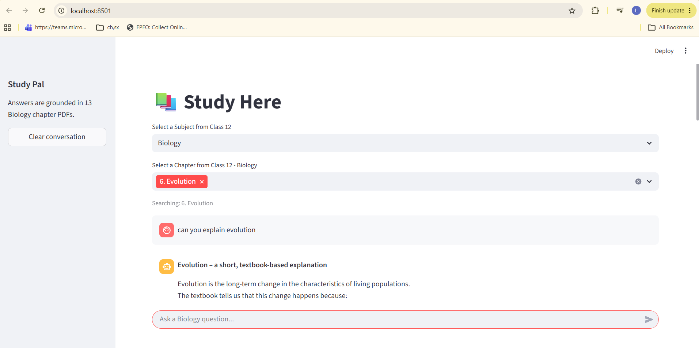
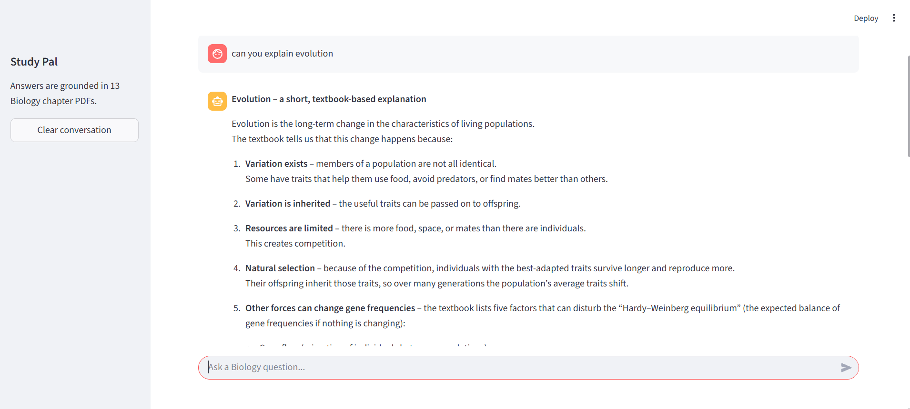
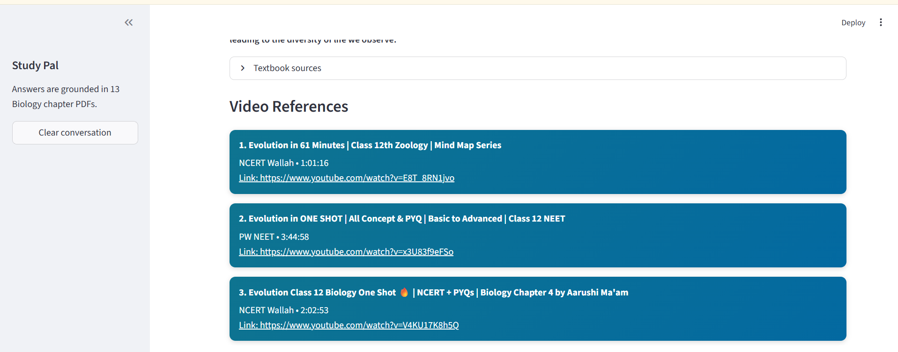
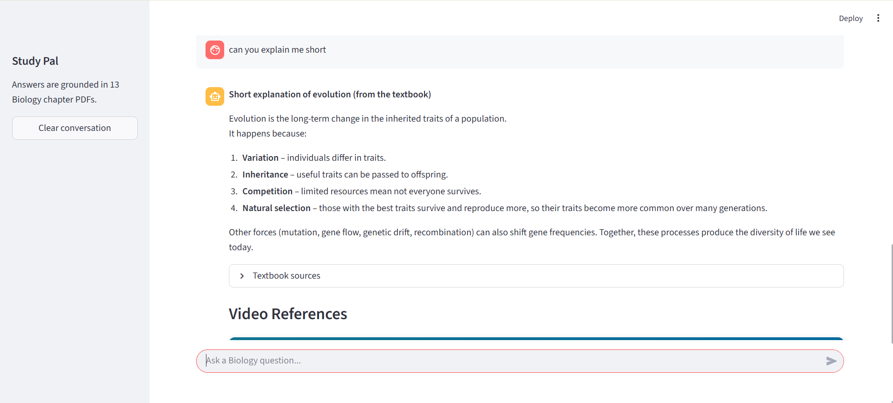
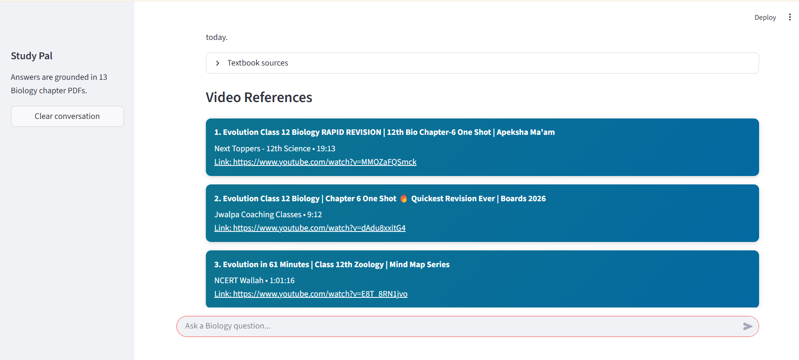
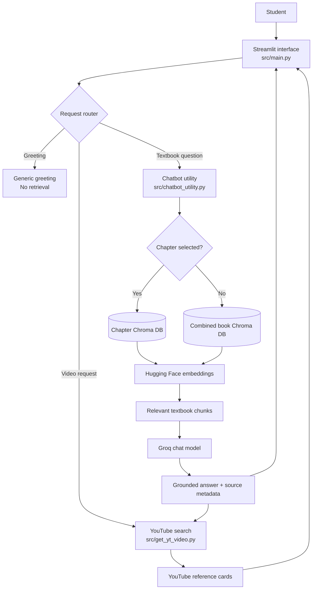

# Study Here

Study Here is a retrieval-augmented learning assistant for Class 12 students. It answers questions from locally indexed textbook PDFs, shows the textbook pages used for each answer, and automatically recommends relevant YouTube lessons.

The current knowledge base contains all 13 Class 12 Biology chapters. Physics, Chemistry, and Mathematics are present in the subject selector and can be enabled after their PDFs and vector databases are added.

## Features

- Subject and chapter selection from a Streamlit interface
- Textbook-grounded answers instead of unrestricted generated responses
- Dedicated chapter retrieval for accurate requests such as "teach me Chapter 6"
- Multi-chapter selection for comparisons and combined questions
- Page-level textbook source references
- Automatic YouTube video references after textbook explanations
- Generic handling for greetings without unnecessary textbook retrieval
- Persistent combined-book and chapter-level Chroma vector databases
- Local Hugging Face embeddings with Groq-hosted answer generation

## Application Preview

### Select a subject and chapter

Choose a Class 12 subject and one or more available chapters. When no chapter is selected, the application searches the complete subject textbook.



### Ask textbook questions

The assistant retrieves relevant pages from the selected chapter and produces a structured, student-friendly explanation.



### Review source pages and video references

Each grounded answer includes collapsible textbook sources. Relevant YouTube lessons are searched automatically and displayed as compact reference cards.



### Request concise explanations

Follow-up questions use the selected chapter and conversation history, allowing students to request shorter explanations or clarification.



### Open recommended lessons

Every video card includes the title, channel, duration, and a direct YouTube link.



## Architecture



### Component responsibilities

| Component | Responsibility |
| --- | --- |
| `src/main.py` | Streamlit interface, subject/chapter selection, chat history, sources, and video cards |
| `src/chatbot_utility.py` | Greeting detection, chapter routing, Chroma retrieval, prompt construction, and Groq responses |
| `src/get_yt_video.py` | YouTube intent detection and related lesson search |
| `src/vectorize_book.py` | PDF loading, text splitting, embeddings, and Chroma persistence |
| `src/vectorize_script.py` | Command-line entry point for configuration checks and vectorization |
| `data_original/` | Source textbook PDFs organized by class and subject |
| `vector_db/` | Generated combined-subject vector database |
| `chapters_vector_db/` | Generated per-chapter vector databases |

## Project Structure

```text
project_StudyHere/
├── data_original/
│   └── class_12/
│       └── biology/
│           ├── 1. Sexual Reproduction in Flowering Plants.pdf
│           ├── ...
│           └── 13. Biodiversity and Conservation.pdf
├── docs/
│   └── images/
├── src/
│   ├── .env
│   ├── chatbot_utility.py
│   ├── env_tamplate.txt
│   ├── get_yt_video.py
│   ├── main.py
│   ├── vectorize_book.py
│   └── vectorize_script.py
├── chapters_vector_db/        # Generated and Git-ignored
├── vector_db/                 # Generated and Git-ignored
├── .gitignore
├── README.md
└── requirements.txt
```

## Technology Stack

- Python 3.12
- Streamlit
- LangChain
- ChromaDB
- Hugging Face Sentence Transformers
- Groq API
- PyMuPDF
- YouTube Search Python

## Setup

### 1. Clone the repository

```powershell
git clone <repository-url>
cd project_StudyHere
```

### 2. Create and activate a virtual environment

```powershell
python -m venv .venv312
.\.venv312\Scripts\Activate.ps1
```

### 3. Install dependencies

```powershell
python -m pip install --upgrade pip
pip install -r requirements.txt
```

### 4. Configure environment variables

Create `src/.env` from `src/env_tamplate.txt` and provide your Groq API key:

```env
GROQ_API_KEY=replace_with_your_key
GROQ_MODEL=openai/gpt-oss-20b
CLASS_SUBJECT_NAME=class_12/biology
```

Never commit the real `.env` file or API key.

### 5. Add textbook PDFs

Place chapter PDFs in a subject directory using numbered, descriptive filenames:

```text
data_original/class_12/biology/
```

### 6. Validate and build the vector databases

```powershell
python .\src\vectorize_script.py --check
python .\src\vectorize_script.py
```

The first run downloads the embedding model and can take several minutes. Subsequent runs reuse the local model cache.

### 7. Start the application

```powershell
streamlit run .\src\main.py
```

Open `http://localhost:8501` if Streamlit does not open the browser automatically.

## How Retrieval Works

1. The student selects a subject and optionally one or more chapters.
2. A greeting is handled locally without querying the textbook or Groq.
3. A chapter-specific question is routed to the matching chapter vector database.
4. A general Biology question is searched against the combined Biology database.
5. Relevant textbook chunks are supplied to the Groq chat model as context.
6. The answer is returned with the source PDF names and page numbers.
7. Related YouTube lessons are searched and displayed below the explanation.

## Adding Another Subject

Physics, Chemistry, and Mathematics already appear in the interface, but they require their own data before chat is enabled.

To add a subject:

1. Create its folder under `data_original/class_12/`.
2. Add chapter PDFs with numbered filenames.
3. Update the subject-to-database configuration in the application.
4. Vectorize the new subject into combined and chapter-level databases.
5. Confirm that questions retrieve only the selected subject's documents.

## Security Notes

- Keep `GROQ_API_KEY` in `.env`; never hard-code or commit it.
- Generated vector databases are ignored by Git because they can be rebuilt from the PDFs.
- Textbook context is sent to the configured Groq model when generating grounded answers.
- YouTube searches send the selected topic or question to the search service.

## Current Status

- Biology: 13 chapters available and vectorized
- Physics: selector available; textbook data not yet added
- Chemistry: selector available; textbook data not yet added
- Mathematics: selector available; textbook data not yet added
